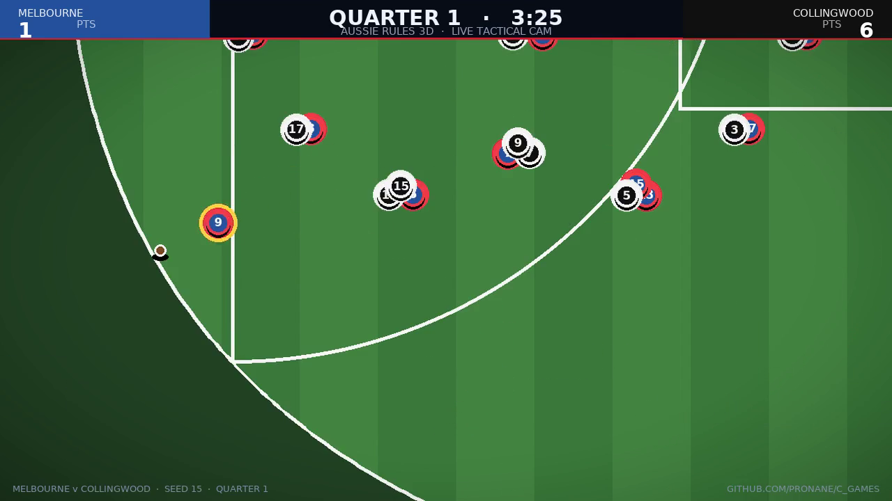

# Aussie Rules 3D 🏉

A full **3D Australian rules football** game — exact **2026 AFL laws**,
rigged and animated players built in **Blender**, a packed **Melbourne
arena**, and one game that plays on **every device**: desktop browser, phone,
tablet, TV, or installed as an app.

| Play anywhere | Real 3D | Real footy |
|---|---|---|
| Keyboard · gamepad · touch · PWA install | Skinned rigs + 11 baked animations, PBR arena, broadcast cam | 18-a-side, marks, handballs, tackles, holding the ball, 50 m penalties, last-disposal OOB |

**[▶ Play it](#quick-start)** · [Install](INSTALL.md) · [Controls](CONTROLS.md) ·
[Rules](RULES.md) · [Deploy](DEPLOY.md) · [3D pipeline](tools/blender/README.md) ·
[Design review](docs/DESIGN_REVIEW.md) · [Gameplay video](docs/gameplay.mp4)

## Quick start

```bash
cd aussie_rules_3d
./install.sh        # Windows: install.cmd  (or .\install.ps1)
./start.sh          # Windows: start.cmd    → http://localhost:8080
```

That's it — one click to install, one click to run, on **macOS, Linux and
Windows**. The game runs in any modern browser (Chrome, Edge, Firefox, Safari)
and can be **installed to your device** as an app (PWA) for offline play.

For development with hot reload: `npm run dev`.

## What makes it feel like real footy

- **Exact rules** — 4 × 20-minute quarters + time-on, goals (6) and behinds
  (1), marks from 15 m, the 15 m bounce law, holding the ball with prior
  opportunity (a shrug counts), 50 m penalties, the 5 m stand rule, kick-ins
  in 8 seconds, 6-6-6 at centre **ball-ups** (the 2026 laws abolished the
  centre bounce), the last-disposal out-of-bounds law between the arcs,
  deliberate rushed behinds, post strikes — see [RULES.md](RULES.md).
- **A Melbourne arena** — a fully enclosed three-tier oval stadium generated
  in Blender: cantilever roof, six light towers, twin big screens showing the
  **live scoreboard**, padded goal/behind posts, behind flags, interchange
  benches on the wing, ~10,000-strong crowd, mown grass with painted lines,
  50 m arcs and goal squares.
- **Real 3D players** — a 19-bone skinned humanoid rig (made in Blender,
  exported as glTF) with 11 baked animation clips: idle, walk, run, sprint,
  run-with-ball, drop-punt kick, handball, tackle, mark jump, celebration and
  hit-the-deck. Kit colours and squad numbers are applied per team.
- **Broadcast presentation** — elevated wing camera that follows the play,
  behind-the-kick set-shot cam, goal celebration orbit, ACES tone mapping,
  soft shadows, sky and crowd, synthesized crowd noise, whistles, kick thuds
  and the final siren.
- **Proper gameplay** — 18-a-side with team AI that plays shape (6-6-6 at
  restarts, leads in attack, man-up in defence, kicks to targets, shoots on
  goal inside 50), three difficulty levels, contest physics for the oval
  ball, and full laws enforcement.

## Gameplay video & design review

[](docs/gameplay.mp4)

**[▶ Watch the first-quarter highlight reel](docs/gameplay.mp4)** — a 40-second
Melbourne v Collingwood montage rendered from the live MatchSim (tactical
tracking camera, score bug, goal banners). The full production-quality review
of the gameplay overhaul — camera research, the swarm/readability fixes,
contextual control hints, the desktop version — is in
[**docs/DESIGN_REVIEW.md**](docs/DESIGN_REVIEW.md).

## Device-agnostic by design

| Where | How |
|---|---|
| Desktop browser | Keyboard + mouse, or any gamepad (with rumble) |
| Desktop app | `npm run desktop` — Electron shell loads the build (see [DEPLOY.md](DEPLOY.md)) · or install as a PWA |
| Phone / tablet browser | Touch controls: virtual stick + big action buttons |
| Installed app (any OS) | PWA — install from the browser, plays offline |
| Two players, one device | Player 2 joins on gamepad 1 (local co-op) |
| Your own server / LAN | `./start.sh` serves on 0.0.0.0 — open it from any device on the network |

## Tests

`npm test` runs the full suite (**86 tests**): every scoring law, marks,
tackling/holding-the-ball, the 15 m bounce law, the 2026 out-of-bounds laws,
kick-ins, 50 m penalties, the stand rule, 6-6-6, the clock, full match
simulation smoke tests (including determinism), and the complete input matrix
(keyboard, gamepad standard mapping, touch layout, dead zones, edge
detection). `npm run verify` additionally checks TypeScript, the production
build and the glTF assets.

## How the 3D pipeline works

All models are authored programmatically with **Blender** (`bpy`, Blender as a
Python module) in [`tools/blender/`](tools/blender/README.md):

1. `gen_player.py` — builds the humanoid body, the 19-bone armature, proximity
   trimmed Sprite Forge squad from Gaelic_Football_3d (3 appearance variants,
   flat AFL club tints at runtime) → `public/assets/gaelic_player.glb`
2. `gen_ball.py` — the Sherrin-style oval ball with laces → `public/assets/ball.glb`
3. `gen_stadium.py` — the Melbourne arena bowl, roof, towers, screens and
   posts → `public/assets/stadium.glb`

Regenerate any time with `npm run assets` (or `node scripts/build-assets.mjs`).
The generated GLBs are committed so the game runs out of the box without
Blender. On headless Linux servers the pipeline auto-builds small stub
libraries so Blender runs without an X stack.

## Project layout

```
aussie_rules_3d/
├── install.sh / install.ps1 / install.cmd    one-click install (macOS/Linux/Windows)
├── start.sh / start.cmd                      one-click run
├── src/
│   ├── rules/     pure, tested laws engine (2026 AFL laws)
│   ├── sim/       ball physics, AI, match simulation
│   ├── render/    three.js world, arena, players, broadcast camera
│   ├── input/     keyboard · gamepad · touch (one action layer)
│   ├── audio/     synthesized crowd, whistles, kicks, siren
│   └── ui/        HUD, radar, menus, touch buttons
├── tests/         86 vitest tests (laws, engine, input, sim)
├── tools/blender/ the Blender asset pipeline (rigs + animation)
├── public/assets/ generated GLB models (committed)
└── scripts/       install.mjs · start.mjs · build-assets.mjs · check.mjs
```

## Tech

three.js · TypeScript · Vite · Vitest · Blender (bpy) · WebAudio · Gamepad API ·
PWA. No server required — the game is a static build that runs anywhere.

MIT licensed. Independent fan project — not affiliated with the AFL or any club.
