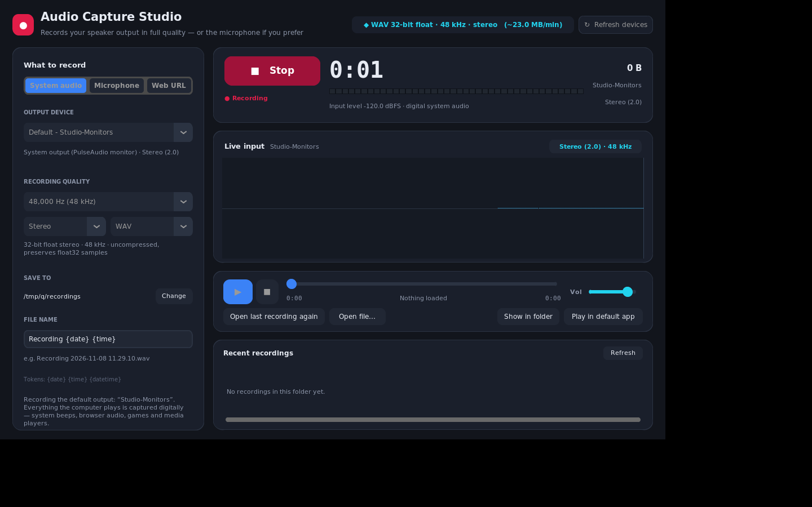
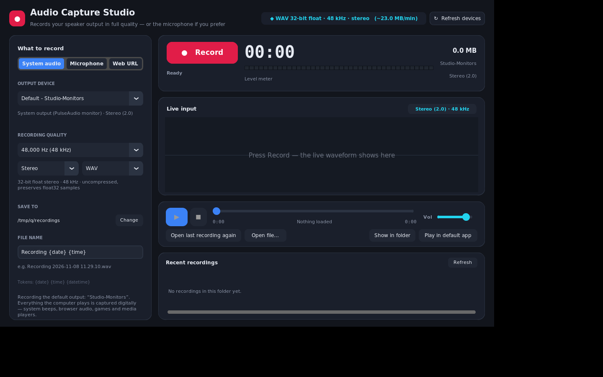
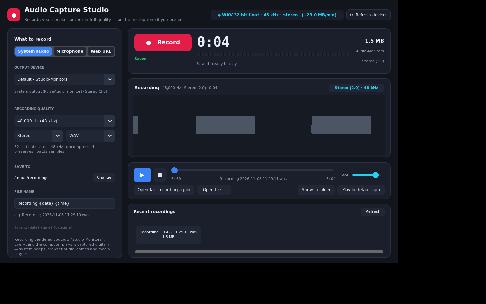

# Audio Capture Studio

A small desktop app that **records what your computer is playing** — the speaker
output — and plays it back. No "record the room with a microphone" nonsense:
the default source is the system audio stream itself, so the recording is a
*digital copy* of exactly what the speakers get.

* **Default source:** system output (Windows: WASAPI loopback, Linux: PulseAudio
  monitor). Your volume slider at 20 % does not make a quiet recording — the
  capture happens before the amplifier.
* **Microphone is still available** with one click, if you want to narrate.
* **Web URL playlist:** paste one `http(s)` URL per line and process them sequentially in your default browser. Separate recordings (number + page title) are the default; choose one combined file instead. Browser sign-in uses the browser's existing OAuth/OIDC, SSO and MFA session. You can explicitly save a playlist; auth/token-like query and fragment parameters are stripped before saving. Capture uses system loopback, so it includes other computer sounds too; it does not extract protected streams or bypass DRM.
* **Playback assist:** best-effort autoplay parameters for supported YouTube/Vimeo player URLs, a meter/status that tells you when system audio is detected, and a Retry URL action. Browser autoplay policies may still require a user click.
* **Full quality:** the device's native sample rate, 48 kHz, or anything up to
  192 kHz. Stored as 32-bit float WAV (or lossless 24-bit FLAC).
* **Playback built in:** seek, pause, volume, waveform with progress.
* **Basic non-destructive editor:** select a range on the waveform or enter start/end seconds, preview it, trim to it or remove it (including a middle cut), and undo/redo. Saving creates a separate edited WAV/FLAC copy; the original remains intact. WAV export keeps float32 samples; FLAC is encoded as lossless 24-bit PCM.
* Windows first, Linux supported, single-file-per-module, no installer needed.



See [the Web URL capture walkthrough](docs/web-url-capture-guide.png) for the browser sign-in flow.

---

## 1. Run it

### Windows (primary target)

1. Install Python 3.9+ from [python.org](https://www.python.org/downloads/windows/)
   — tick **"Add python.exe to PATH"**.
2. Double-click **`run_windows.bat`**.

The first run creates a private `.venv` and installs the four dependencies
(`soundcard`, `numpy`, `customtkinter`, and `soundfile` for FLAC); later runs
start instantly. Nothing else to install — no virtual audio cable, no
VoiceMeeter, no drivers.

Prefer the command line?

```bat
pip install -r requirements.txt
python audiocapture_app.py
```

### Linux

```bash
./run_linux.sh            # creates .venv, installs deps, launches
```

Requires a running PulseAudio or PipeWire server (`pulseaudio` or
`pipewire-pulse`) and Tk (`sudo apt install python3-tk`). On PipeWire, the
`pipewire-pulse` compatibility daemon provides the monitor sources.

---

## 2. Using it

| Action | How |
| --- | --- |
| Record | Press the big **Record** button (or `Ctrl+R`) |
| Pause / resume | Use **Pause** during a recording to omit an interruption; press **Resume** to continue the same file. Paused time is not added as silence. |
| Stop & save | Press **Stop** (same button) |
| Play the recording | It loads automatically — press ▶ (`Space` or `Ctrl+Space`) |
| Seek | Drag the slider, or `←` / `→` (`Shift` = fine, 1 s) |
| Choose what to capture | **System audio**, **Microphone**, or **Web URL** |
| Web URL playlist | Choose **Web URL**, paste URLs one per line, then **Start playlist**. It opens the selected page and starts capture. **Next URL** saves/starts the next separate file by default, or advances the combined file. |
| Autoplay / playback checks | Try autoplay for supported YouTube/Vimeo players; if the browser blocks it, sign in or click Play. The level meter changes to **Browser audio detected** when the system mix becomes active. |
| Retry URL | Reopens the current/selected URL in your default browser without restarting the recording. |
| Save a playlist | Name it and choose **Save safe copy**. Auth-token-like query/fragment parameters are stripped; the browser session handles sign-in. |
| Change device | *Output device* dropdown (all outputs are listed, default marked) |
| Change quality | Sample-rate / Stereo-Mono / WAV-FLAC menus |
| Where files go | **SAVE TO → Change** (defaults to `Music/Audio Capture`) |
| File naming | `Recording {date} {time}` — tokens: `{date} {time} {datetime} {YYYY} {MM} {DD} {hh} {mm} {ss}` |
| Open an existing file | **Open file…** (`Ctrl+O`) |

Recordings are listed in **Recent recordings**; the last one is also reachable
with **Open last recording again**, **Show in folder** and **Play in default app**.

Everything (device, rate, folder, volume, window mode) is remembered between
runs in `%APPDATA%\AudioCapture\settings.json`
(`~/.config/AudioCapture/settings.json` on Linux).

---

## 3. About quality — what "HD" actually means here

* **The capture is digital.** WASAPI loopback and PulseAudio monitors read the
  mixed stream *before* it is sent to the D/A converter and amplifier. WAV
  stores the captured float32 samples; recording at 30 % speaker volume does
  not give you a 30 %-level file.
* **Sample rate.** The menu offers 44.1 → 192 kHz, with the device's own rate
  marked **native** and chosen by default. If Windows is set to 48 kHz (the
  norm) you get 48 kHz; if your DAC is set to 96 kHz you get 96 kHz. Higher
  settings are resampled by the OS mixer, so they cannot add detail that was
  not there — the honest choice is the native one, which is the default.
* **File formats.** Choose **WAV** to retain the captured float32 samples exactly
  (uncompressed), or **FLAC** for lossless compression of 24-bit PCM. FLAC is
  lossless after conversion to 24-bit integer PCM; that conversion can discard
  precision below 24 bits compared with the original float32 samples. WAV is the
  exact-capture choice; FLAC is the smaller practical choice. FLAC size depends
  on content (often around one-third of WAV).
* **Stereo vs mono.** Stereo by default. Mono sums left+right; note that this
  cancels anything that is perfectly out of phase — choose Stereo for music.
* **Size guide:** 48 kHz stereo float32 ≈ **23 MB/min**; 48 kHz stereo FLAC ≈
  about **8 MB/min** for typical material; FLAC size varies with content. The
  header estimate is approximate.

### Things worth knowing

* **Windows:** the app records the *default* output unless you pick another.
  Apps running **as administrator** play into a different mixer instance and
  will be silent in the capture — run this app as administrator if you need to
  record those. DRM-protected audio (some streaming services) is deliberately
  blocked by Windows for all loopback recorders; nothing to do about that.
* **Silence is kept.** If nothing is playing, the file keeps its length (filled
  with digital silence) so it stays in sync with the real timeline.
* Long recordings are **streamed from disk** on playback once a file passes
  ~256 MB, so a two-hour capture won't exhaust RAM.
* If the very first capture is silent, the app tells you so instead of leaving
  you wondering.

---

## 4. Troubleshooting

| Symptom | Fix |
| --- | --- |
| "Audio backend unavailable" on Windows | `pip install --force-reinstall soundcard` inside `.venv` |
| "Audio backend unavailable" on Linux | Start PulseAudio/PipeWire (`systemctl --user start pipewire-pulse`) |
| Recording is silent | Check the selected output is the one actually playing; run Windows audio troubleshooting; see the administrator note above |
| No devices listed | Press **Refresh devices**; on Windows check Sound settings for a disabled endpoint |
| Crackles / dropouts | Use the native sample rate and close CPU-heavy apps; the writer thread is decoupled from capture, but a starved CPU still starves |
| App won't start at all | Run `python audiocapture_app.py` in a terminal to see the traceback |

A 10-second end-to-end check (enumerates devices and does a test capture with a
live level meter):

```bash
python tests/selftest.py
```

---

## 5. Build a Windows installer (optional)

On Windows, install Python 3 and [Inno Setup 6](https://jrsoftware.org/isinfo.php),
then double-click `build_windows.bat`. It creates a self-contained app bundle in
`dist\AudioCaptureStudio\` and, when Inno Setup is installed, an installer at
`dist\AudioCaptureStudio-Setup.exe`. The installer adds Start Menu shortcuts
and an uninstaller. A recipient installs it once; the installed app does not
need Python, pip, or repeated downloads to launch. Build the Windows installer
on Windows (PyInstaller does not cross-compile Windows executables from Linux).

---

## 6. Screens

| | |
| --- | --- |
|  |  |
| Ready to record | Saved, loaded and ready to play |

---

## 7. Project layout

```
AudioCapture/
├── audiocapture_app.py        # entry point (double-click this)
├── run_windows.bat            # Windows launcher (creates .venv, installs, runs)
├── run_linux.sh               # Linux launcher
├── requirements.txt
├── audiocapture/
│   ├── audio.py               # device discovery + loopback/monitor resolution
│   ├── recorder.py            # capture thread, writer thread, WAV/FLAC, player
│   ├── ui.py                  # the window
│   ├── waveform.py            # live scope + whole-file overview
│   ├── dialogs.py             # dark themed modal dialogs
│   └── settings.py            # settings store, file naming, OS helpers
├── docs/                      # screenshots
├── packaging/audiocapture.spec
└── tests/
    ├── selftest.py            # device + capture diagnostics
    ├── smoke_test.py          # file format / timeline / playback tests
    ├── test_linux_devices.py  # Linux monitor-source resolution (mocked)
    └── ui_preview.py          # headless screenshot harness
```

### How capture works, briefly

* A **capture thread** pulls fixed-size blocks from the OS at the requested rate.
* A **writer thread** encodes them (batched ~250 ms) so a slow disk can never
  stall the audio stream; short stalls are padded with silence to keep the
  timeline honest, and captured audio is never discarded.
* The UI polls level/waveform data from a lock-protected buffer — no GUI work
  ever happens on the audio thread.

Dependencies: `soundcard` (WASAPI / PulseAudio bindings), `numpy`,
`customtkinter` (Tk-based UI), optional `soundfile` (FLAC + extra formats).
